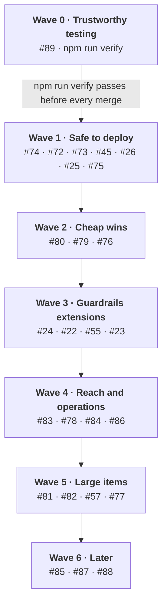

# apra-agent-kit Roadmap

Last updated: 2026-11-03

The 26 open issues are grouped into seven waves, worked one issue at a time. Every merge must
first pass one local black-box command, `npm run verify`.

## Wave roadmap

Waves run top to bottom; within a wave, issues run in the order shown, and each one merges only
after `npm run verify` passes.

## Issue tracker

Work top to bottom; an issue starts only when everything in its Depends on column is Done. Sizes
are rough: S is about a day, M a few days, L a week or more.

| Wave | Issue | What | Size | Depends on | Status |
| --- | --- | --- | --- | --- | --- |
| 0 | [#89](https://github.com/Apra-Labs/apra-agent-kit/issues/89) | e2e shows green while failing; Host validation bug | S | none | Not started |
| 0 | new | `npm run verify`: all tests plus `npm run smoke` in one command | S | #89 | Not started |
| 1 | [#74](https://github.com/Apra-Labs/apra-agent-kit/issues/74) | Warn when approvals run with the default login | S | verify | Not started |
| 1 | [#72](https://github.com/Apra-Labs/apra-agent-kit/issues/72) | Hide secrets wherever tool data is saved or logged | M | verify | Not started |
| 1 | [#73](https://github.com/Apra-Labs/apra-agent-kit/issues/73) | Scan for prompt injection | M | #72 | Not started |
| 1 | [#45](https://github.com/Apra-Labs/apra-agent-kit/issues/45) | Per-run write cap, record who approved | S | verify | Not started |
| 1 | [#26](https://github.com/Apra-Labs/apra-agent-kit/issues/26) | Audit log of approvals and denials | S–M | #45, #72 | Not started |
| 1 | [#25](https://github.com/Apra-Labs/apra-agent-kit/issues/25) | Tool output inspection: close or keep only deny | XS | #72, #73 | Not started |
| 1 | [#75](https://github.com/Apra-Labs/apra-agent-kit/issues/75) | Update the roadmap doc | XS | none | In review |
| 2 | [#80](https://github.com/Apra-Labs/apra-agent-kit/issues/80) | Cut oversized tool output | S | verify | Not started |
| 2 | [#79](https://github.com/Apra-Labs/apra-agent-kit/issues/79) | Triage: answer simple questions directly | S | verify | Not started |
| 2 | [#76](https://github.com/Apra-Labs/apra-agent-kit/issues/76) | Skills phase 1: the agent reads skills | S–M | verify | Not started |
| 3 | [#24](https://github.com/Apra-Labs/apra-agent-kit/issues/24) | Rate limits per tool | S–M | verify | Not started |
| 3 | [#22](https://github.com/Apra-Labs/apra-agent-kit/issues/22) | Policies per user and role | M | #74 | Not started |
| 3 | [#55](https://github.com/Apra-Labs/apra-agent-kit/issues/55) | Guardrails per agent (decide with #22) | M | #22 | Not started |
| 3 | [#23](https://github.com/Apra-Labs/apra-agent-kit/issues/23) | Change policies at runtime | M | #22, #55 | Not started |
| 4 | [#83](https://github.com/Apra-Labs/apra-agent-kit/issues/83) | OpenAI-compatible endpoint | M | verify | Not started |
| 4 | [#78](https://github.com/Apra-Labs/apra-agent-kit/issues/78) | Search past runs | S–M | #72 | Not started |
| 4 | [#84](https://github.com/Apra-Labs/apra-agent-kit/issues/84) | Monitoring with OpenTelemetry | M | #72 | Not started |
| 4 | [#86](https://github.com/Apra-Labs/apra-agent-kit/issues/86) | Shrink the context of long runs | M | #80 | Not started |
| 5 | [#81](https://github.com/Apra-Labs/apra-agent-kit/issues/81) | More LLM providers with fallback | L | verify | Not started |
| 5 | [#82](https://github.com/Apra-Labs/apra-agent-kit/issues/82) | Slack and Teams | M each | #74 | Not started |
| 5 | [#57](https://github.com/Apra-Labs/apra-agent-kit/issues/57) | Live-mode human input over SSE / WebSocket | M–L | verify | Not started |
| 5 | [#77](https://github.com/Apra-Labs/apra-agent-kit/issues/77) | Skills phase 2: agent proposes skills | M | #76, #73 | Not started |
| 6 | [#85](https://github.com/Apra-Labs/apra-agent-kit/issues/85) | Smart approval | M | #45 | Not started |
| 6 | [#87](https://github.com/Apra-Labs/apra-agent-kit/issues/87) | Skills phase 3: upkeep and sharing | M | #77 | Not started |
| 6 | [#88](https://github.com/Apra-Labs/apra-agent-kit/issues/88) | Delegation to helper agents | M–L | #81 helps | Not started |

## Testing end to end

One command, `npm run verify`, runs every test and then black-box tests a real running agent on
your machine, with no Docker, no token and no CI. Most of it exists: `npm run smoke` already does
the black-box half. The missing piece is running every other test first, plus the Docker targets.

**What already exists**

- `npm run smoke` (`scripts/smoke-test.mjs`): starts the host with the scripted LLM on a free port,
  waits for `/health`, runs the e2e suite, prints a summary, shuts the host down and exits 0 or 1.
  `npm run smoke:live` does the same with a real model.
- A black-box suite, `tests/e2e/task.e2e.test.mjs`, that only talks HTTP to `BASE_URL` and never
  imports host code. It runs 5 scenarios from `tests/e2e/scenarios/` plus a health check.
- A scripted LLM: with `NODE_ENV=test` and `FLEET_MOCK_SCRIPT=tests/e2e/scripted-llm.json`, the
  host replays canned model and tool answers (`host/index.mjs:93`). Runs are offline and give the
  same result every time.
- 122 test files, split across 15 `test:*` scripts. `npm test` runs only the pool, create and MCP
  files, so most host tests are never run together.

**What `npm run verify` does**

1. **All tests:** runs every `tests/**/*.test.mjs` file in one go (unit, host, acceptance), not 15
   separate scripts. This is the new part.
2. **Black-box run:** calls `npm run smoke`, which starts the agent with the scripted LLM, runs the
   e2e scenarios against it and stops it.
3. **Report:** prints one pass/fail table covering both steps, saves the agent log on failure, and
   exits non-zero if anything failed.

**Options**

| Command | What it adds | Needs |
| --- | --- | --- |
| `npm run verify` | Everything above, local process | Node only |
| `npm run verify -- --docker` | Same suite against the VM container | Docker |
| `npm run verify -- --azure` | Same suite against Azure Functions + Azurite | Docker |
| `npm run verify -- --live` | The black-box run with a real model (`smoke:live`) | `CLAUDE_CODE_OAUTH_TOKEN` |

**How it grows**

- Every issue's "done when" becomes a scenario file in `tests/e2e/scenarios/`, with its canned
  answers in the scripted LLM. Fixing an issue means its scenario passes and all older ones still
  pass.
- Surfaces to add first, because no scenario covers them yet: MCP tool calls (`/mcp`), chat
  routes, approve and deny, cancel, queue full (429), webhook delivery, the scheduler, the kill
  switch, budget stops.
- Optional: a local git `pre-push` hook that runs `npm run verify`, so a broken branch can't be
  pushed. It stays on your machine, not in CI.

**Rule for merging:** a PR merges only after `npm run verify` passes on its branch, and the PR
description pastes the summary table.

# Phase 1 detail

## Goal and scope

Phase 1 makes the kit safe to deploy by fixing the risks that come from the kit's own code, not
from choices adopters make. It covers four GitHub issues on Apra-Labs/apra-agent-kit, delivered as
four small PRs off `main`.

| Issue | What it delivers | Effort |
| --- | --- | --- |
| [#72](https://github.com/Apra-Labs/apra-agent-kit/issues/72) | One redaction module, applied on every path that saves or logs tool data | M |
| [#73](https://github.com/Apra-Labs/apra-agent-kit/issues/73) | Prompt-injection scanning of tool results and memory writes | M |
| [#74](https://github.com/Apra-Labs/apra-agent-kit/issues/74) | Startup warning when approvals run with the default anonymous login | S |
| [#75](https://github.com/Apra-Labs/apra-agent-kit/issues/75) | `docs/roadmap.md` brought up to date | XS |

Out of scope: building a real authenticator (adopters inject their own), tool-output inspection
policies beyond redaction ([#25](https://github.com/Apra-Labs/apra-agent-kit/issues/25)), and audit
logging ([#26](https://github.com/Apra-Labs/apra-agent-kit/issues/26)).

## Current state

The kit has one partial secret filter, no injection defence, a silent anonymous default, and a
stale roadmap. Checked against `origin/main` at 5c5b008.

| Area | What exists | Gap |
| --- | --- | --- |
| Secrets | `scrub()` in `host/checkpoint/record.mjs:65` drops keys named like credentials; a local regex in `comm/azure-functions/advance.mjs:49` | Values are not checked (`?api_key=` in a URL, `Bearer ...` in a string). Job history saves raw args and results (`host/jobs/in-process.mjs:60`). Logger, transcripts and conversation memory have no filter. |
| Injection | Tool results enter run history through `remember()` (`host/strategies/plan-execute.mjs:334`, `host/strategies/open-ended.mjs:119`); the learner stores facts at `host/memory/learner.mjs:107` | Nothing inspects tool results before they reach the prompt or before a fact is saved. |
| Auth | `startHost({ authenticate })` defaults to the stub in `mcp/auth.mjs`, which returns `anonymous`. Both Express and Azure adapters receive it from `host/index.mjs:340` | With `humanInput` on (`host/index.mjs:158`), approvals are attributed to `anonymous` and nothing warns. |
| Roadmap | `docs/roadmap.md`, last updated 2026-09-30 | Lists memory and evals as not built; omits human input, checkpoints, Azure entity storage, retention. |

## #72 Redact secrets on every write path

One new module, `host/redact/index.mjs`, becomes the only place secrets are removed, and it is
applied at the store boundary so every backend gets it. Today `scrub()` is called by checkpoints
and the Azure entities, but the in-process job stores (`host/jobs/store/sqlite.mjs`, `memory.mjs`,
`cosmos.mjs`), the memory stores and the logger skip it.

**Design**

- `redact(value)` walks objects like `scrub()` does, and also checks string **values** against
  patterns: bearer and basic auth headers, `?api_key=` / `token=` query strings, `sk-` / `ghp_` /
  `xox*-` style keys, connection strings, JWTs.
- Masking: tokens under 18 characters are fully masked; longer ones keep the first 6 and last 4
  characters so logs stay debuggable.
- `scrub()` keeps its name and becomes a thin call to `redact()`, so the existing checkpoint and
  entity callers need no change.
- Adopters add their own patterns with `guardrails.redactPatterns`.

**Tasks**

- [ ] Create `host/redact/index.mjs` with key and value rules; move `CREDENTIAL_ROOTS` there from
      `host/checkpoint/record.mjs`.
- [ ] Re-point `scrub()` in `host/checkpoint/record.mjs` at `redact()`.
- [ ] Replace the local regex in `comm/azure-functions/advance.mjs:49` with `redact()`.
- [ ] Wrap `appendEvent` and record writes in `host/jobs/store/resolve.mjs` so SQLite, memory and
      Cosmos stores all redact.
- [ ] Redact in the memory stores (`host/memory/store/`, `host/memory/conversation-store/`) and in
      `host/chat/transcript.mjs`.
- [ ] Redact log arguments in `host/logger.mjs` `formatMessage()`.
- [ ] Read `guardrails.redactPatterns` in `host/config.mjs`; document it in `docs/CONTRACT.md`.

**Done when**

- A test task whose tool args and results contain a bearer token, a `?api_key=` URL and an `sk-`
  key leaves none of them in the job store, checkpoint, transcript, memory or log output.
- The existing `scrub()` and checkpoint tests pass unchanged.

## #73 Scan for prompt injection

A new module, `host/safety/threats.mjs`, scans untrusted text and either marks it or blocks it,
depending on where the text is going. Marking is used where blocking would break a task; blocking
is used where the text would be stored and reused.

**Design**

| Where the text goes | Scope | Action on a match |
| --- | --- | --- |
| Tool result into run history | context | Wrap in an untrusted-content block, add a warning line, emit `tool:result:flagged` |
| Recalled memory into the prompt | context | Same as above |
| Fact into long-term memory | strict | Drop the fact, emit `memory:write:blocked` |

- Patterns target unambiguous attack wording: "ignore previous instructions", role hijack ("you
  are now"), requests to send data to a URL, hidden instructions in HTML comments or zero-width
  characters. Ordinary imperative English is not matched.
- Each pattern has an id, so events and tests can name what matched.
- Off switch: `guardrails.injectionScan: 'off' | 'warn' | 'block'`, default `warn` for context and
  `block` for memory writes.

**Tasks**

- [ ] Create `host/safety/threats.mjs` with the pattern list and `scan(text, scope)`.
- [ ] Call it in `remember()` for tool observations in `host/strategies/plan-execute.mjs` and
      `host/strategies/open-ended.mjs`.
- [ ] Call it in `host/memory/learner.mjs` before `longTermMemory.store()` (line 107).
- [ ] Call it on recalled facts in `host/memory/preloader.mjs`.
- [ ] Emit the two events through the existing memory and run event emitters.
- [ ] Document the scopes and the config switch in `docs/memory.md` and `docs/run-loop.md`.

**Done when**

- A fixture tool result with an injection attempt is flagged in history, and the learner refuses
  to store a fact derived from it.
- The existing eval suites (`evals/suites/demo.json`, `travel-agent.json`) produce zero flags.

## #74 Warn when approvals run with the default login

One check in `startHost()` prints a clear warning when approvals are possible and nobody has
injected an authenticator. Both the Express and Azure adapters get their authenticator from
`host/index.mjs`, so one check covers both.

**Tasks**

- [ ] In `host/index.mjs`, after `humanInputConfig` is resolved (line 158), detect
      `authenticate === defaultAuthenticate` while human input is enabled or any tool resolves to
      the `approve` policy.
- [ ] Log one warning naming the risk (approvals recorded as `anonymous`, anyone who can reach
      `/jobs/:id/input` can approve) and the fix (`startHost({ authenticate })`).
- [ ] Add `guardrails.requireAuthForApproval: true`, which refuses to start instead of warning.
- [ ] Note it in `docs/human-input.md` and `docs/getting-started.md`.

**Done when**

- Starting with human input on and the default authenticator logs the warning; with a custom
  authenticator it does not; with `requireAuthForApproval` it refuses to start.
- A `verify` scenario checks the warning appears in the agent log.

## #75 Update the roadmap doc

`docs/roadmap.md` is rewritten last in wave 1, so it can list wave 1 itself as shipped.

- [ ] Move memory, the eval harness, durable human input, checkpoints, Azure entity storage and
      retention to **Shipped**, each linked to its doc.
- [ ] Replace **Next Up** with waves 2 to 6 from the tracker above, linking each issue.
- [ ] Bump the "Last updated" date.

## Order and branches

Wave 1 runs in tracker order: #74, #72, #73, #45, #26, #25, #75. Each issue gets its own branch off
`main` (for example `feature/74-auth-warning`) and its own PR, so a slow review never blocks the
next item.

## Testing per item

Each item adds its "done when" checks as unit tests and as one black-box scenario, then passes
`npm run verify` before its PR opens. #72 adds a scenario that sends secrets through a task and
greps every store and log; #73 adds one with a poisoned tool result.

## Risks and open questions

- Value-pattern redaction can mask non-secrets that look like keys; the test corpus must include
  long IDs and hashes that should survive.
- Injection patterns that are too broad flag normal pages; tune them against the eval suites before
  turning on `block` for memory.
- Open: should redaction also run on tool results before they reach the LLM (#25), or only on what
  is stored?
- Open: who owns #89, since it was opened by s-k-agrawal on 2026-10-30?
- Open: should `npm run verify` start the agent as a local process by default, or in Docker to
  match deployments?
